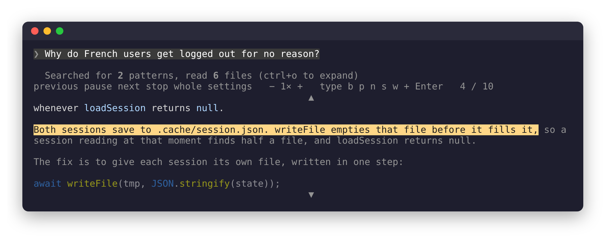
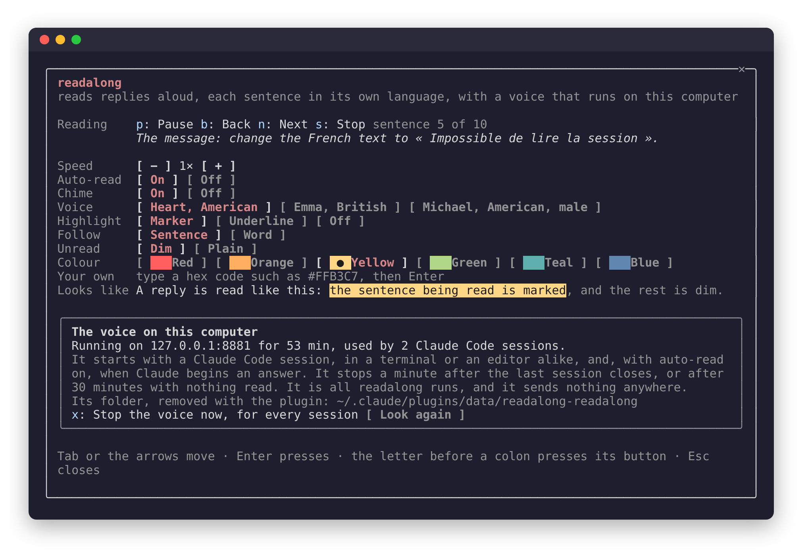

<p align="center">
  
</p>

<h3 align="center">Listen to Claude Code's replies while you read them.</h3>

<p align="center">
  Press play under a reply to hear it. As the voice reads, the current sentence is highlighted,
  so you can follow along in the text. Everything runs on your computer: nothing is sent online,
  and no Claude tokens are used.
</p>

<p align="center">
  readalong is made for English. It also reads French, Spanish, Italian, Portuguese and Hindi with
  a native voice for each, as well as German and Dutch with an English accent.
  See <a href="#languages">Languages</a>.
</p>

<p align="center">
  Windows · macOS · Linux &nbsp;|&nbsp; MIT
  <br>
  <a href="#install">Install</a> · <a href="#how-to-use-it">How to use it</a> · <a href="#languages">Languages</a> · <a href="#settings">Settings</a> · <a href="#what-runs-on-your-computer">What runs on your computer</a> · <a href="#if-something-goes-wrong">Help</a>
</p>

https://github.com/user-attachments/assets/87db12aa-d677-4d5a-8c28-ccdaa16e1139

## Install

readalong works on Windows, macOS and Linux with an up-to-date Claude Code. Installing it from
Claude Code needs [Git](#what-your-computer-needs), because Claude Code downloads plugins from
GitHub with it. Pick the way that matches how you use Claude Code.

**In a terminal**, run this command inside Claude Code:

```
/plugin install readalong --marketplace ibouftini/readalong
```

**In VS Code**, the Claude Code extension installs plugins from a menu:

1. Type `/` and pick **Manage plugins**.
2. Under **Marketplaces**, enter `ibouftini/readalong` and press **Add**.
3. Under **Plugins**, install readalong.

Then start a new Claude Code session. A play button now appears under each reply.

The first time you press it, readalong asks to download the voice. The download is about 400 MB
and happens only once; on a good connection it takes a minute or two. You can keep working while
it runs. As soon as it finishes, the reply is read.

**With the setup script.** If you prefer to install everything at once, the setup script installs
the plugin and the voice together, then plays a test sentence so you know it works:

```bash
git clone https://github.com/ibouftini/readalong
sh readalong/setup.sh                                                     # Linux, macOS
powershell -ExecutionPolicy Bypass -File readalong\setup.ps1              # Windows
```

Add `--voice-only` to install only the voice.

**Without Git**, download the source code zip of the
[latest release](https://github.com/ibouftini/readalong/releases/latest), unzip it, rename the
folder to `readalong` and run the setup script from it, as above. Claude Code then reads the plugin
from that folder, so keep it where it is. To update, unzip the next release into the same folder,
replacing its files, and start a new Claude Code session.

### What your computer needs

**Git.** Claude Code downloads plugins from GitHub with Git, so installing from `/plugin` or the
VS Code menu fails without it, with the message `Executable not found in $PATH: "git"`. To check,
run `git --version` in a terminal. To install it:

- **Windows:** run `winget install --id Git.Git -e` in a terminal, or download it from
  [git-scm.com](https://git-scm.com/download/win). Then restart VS Code or the terminal, so Claude
  Code finds it.
- **macOS:** run `xcode-select --install`. Git comes with Apple's command line tools.
- **Linux:** install it from your package manager, for example `sudo apt install git`,
  `sudo dnf install git` or `sudo pacman -S git`.

If you would rather not install Git, use the setup script from a download, as described above.

Nothing else has to be installed beforehand. The install downloads
[uv](https://docs.astral.sh/uv/), a tool that sets up the exact Python version and packages the
voice was tested with. This copy of Python is kept separate from any Python you already have. The voice runs on:

- Windows 10 and 11 (x64, and ARM through Windows 11's x64 emulation)
- macOS 13 or later (Apple silicon and Intel)
- Linux (x64 and ARM), where the sound is played by PipeWire, PulseAudio, ALSA or FFmpeg,
  whichever you have

### Remove it

To remove readalong, uninstall the plugin. In a terminal, run:

```
/plugin uninstall readalong@readalong
```

In VS Code, type `/`, pick **Manage plugins**, then uninstall readalong under **Plugins**. If you
used the setup script, `sh setup.sh --uninstall` (or `setup.ps1 --uninstall` on Windows) removes
everything, including the marketplace.

Uninstalling removes everything the install added. All of it sits in one folder,
`~/.claude/plugins/data/readalong-readalong`, which Claude Code deletes together with the plugin.
If the voice is running at that moment, it notices and stops within a few seconds. The only other
files it makes are short sound clips in your temporary folder, which it deletes when it stops.
readalong never changes your shell settings, installs system packages, or adds anything that starts
with your computer.

Two things stay because you added them yourself: the marketplace entry in Claude Code (under
**Marketplaces** in `/plugin`), and the cloned folder if you used the setup script.

## How to use it

- **Follow along.** The sentence being read is highlighted in the reply, and the text not read yet
  is dim, so what has been read stands out. If you find it easier to keep your place one word at a
  time, pick **Word** under Follow in the gear menu: each word then lights up as it is spoken. Pick
  **Plain** under Unread to keep the whole reply undimmed.
- **Control the reading.** The player under the reply lets you go to the previous or next sentence,
  pause, stop, and change the speed from 0.5x to 2x. A new speed starts the current sentence again
  at that speed.
- **Read long replies without scrolling.** A reply too tall to read without scrolling is shown in a
  window of ten lines while it is read. The window moves on with the reading: what has been read
  leaves at the top, and what comes next appears at the bottom, so the sentence being read stays in
  view. A ▲ above the text or a ▼ below it shows that more of the reply is there. Code and tables
  pass through the window as they are. To see the whole reply, press **Show the whole reply** in the
  player; press it again to go back to the window. The reading goes on where it was, and the choice
  is kept for the next long reply. A shorter reply is always shown whole.
- **Auto-read.** Turn it on in the gear menu to have each answer read as soon as Claude finishes
  it. A soft chime plays first.
- **Choose a voice.** Heart (American woman), Emma (British woman) and Michael (American man) are
  the best-rated English voices of Kokoro, the voice model readalong uses. Each one says hello when
  you pick it. If a reading is in progress, the current sentence starts again in the new voice.
- **Change the highlight.** The gear menu also sets the highlight style: a marker or an underline,
  in one of six colours. Changes apply immediately. `/readalong` has the same settings, plus a
  custom colour by hex code and a sample sentence to preview it.
- **Natural reading.** File paths, line numbers, dates, units and simple maths are spoken the way a
  person would say them. Code blocks, tables, equations set on their own lines (`$$ … $$`) and web
  addresses are skipped: they stay on screen, and the reading goes on after them. Links are read by
  their text.
- **Quiet when you talk.** Sending a message stops the reading. So does speaking: when a program
  starts recording from your microphone, for dictation or a call, the voice goes quiet. An answer
  that finishes during a recording is not read automatically, though the play button still works.
- **One voice for all your sessions.** If Claude Code is open in several projects, two answers are
  never read over each other. An answer that finishes during another reading only plays its chime,
  so you know it is ready. With the chime turned off, it stays silent.
- **Quick to start.** The voice starts with your Claude Code session in about two seconds. While
  one sentence plays, it prepares the next ones.

### In a terminal

Claude Code draws a terminal session in one of two layouts, picked when the session starts. In the
fullscreen layout, mouse clicks work and `/readalong` opens beside the conversation, once the
window is at least 110 columns wide. In the classic layout, clicks never reach a plugin, so the
buttons under a reply do not respond and `/readalong` opens above the prompt.

When you have not chosen a layout, Claude Code picks one for each session, so two sessions can
differ. To get the same layout every time, type `/tui fullscreen` (or `/tui classic`) once. Claude
Code saves the choice and restarts the session in it, keeping the conversation.

Everything also works from the keyboard, in both layouts:

- **Read the last answer:** type `r` and press Enter.
- **Control the reading:** type `b` to go back, `p` to pause or resume, `n` to skip ahead or `s`
  to stop, then press Enter. In a long reply, `w` switches between the window and the whole reply.
  The player reminds you of these letters while a reply is read. These
  one-letter messages go to readalong instead of Claude, which Claude Code notes in the
  conversation. Any longer message goes to Claude as usual and stops the reading.
- **Open `/readalong`** to get a panel with the same controls, the speed, all the settings and the
  voice's status. From there you can also stop the voice (`x`). Move with Tab or the arrow keys,
  select with Enter, close with Esc. Sending a message closes it too. The panel's last line says
  whether clicks work in it.

A long reply being read in a terminal: the player lists the letters, and the reply is shown in its
window, the sentence being read marked and the rest dim.



The `/readalong` panel while a reply is read:



Auto-read needs no key at all: once it is on, each answer is read when Claude finishes it.

## Languages

readalong is made for English, but it can follow a reply that changes language. Each sentence is
read in the language it is written in. A French reply with one English sentence, or a translation
inside an English answer, is therefore read correctly. There is nothing to set up for this.

How a language sounds depends on whether Kokoro has a voice for it:

| Languages | Read by |
|---|---|
| English | the voice you picked: Heart, Emma or Michael |
| French, Spanish, Italian, Portuguese (Brazil), Hindi | a native voice for that language. If you picked Michael, it is a man's voice, except in French, where Kokoro has only a woman's voice. |
| German, Dutch | the voice you picked, using German or Dutch pronunciation. Kokoro has no voice for these languages, so you will hear an English accent. |

A few rules keep the reading predictable:

- **When in doubt, readalong stays in English.** A sentence switches language only when its words
  clearly belong to another one. Names (La Liga) and borrowed words (faux pas, déjà vu) stay in
  English. A very short sentence, like "Done." or "Parfait.", keeps the language of the sentences
  around it.
- **A quote in another language is read in that language.** When an English sentence quotes a
  French error message ("le fichier est introuvable"), the quote is read by the French voice and
  the rest of the sentence by yours. This works for quotation marks of any kind, parentheses,
  brackets, bold and italics, as long as the quote has three words or more.
- **English inside another language keeps the sentence's voice.** In a French sentence, an
  English error message or button name (« Cannot read properties of undefined », **Save all
  changes**) is read by the French voice, with English pronunciation, as a French speaker would
  read it aloud.
- **A sentence can change language after a comma.** In "She whispered, c'est plus facile que tu
  ne le crois", the first part is read in English and the second in French.
- **Translations are read in their language.** In a list such as "French: Fichier introuvable",
  the label is read in English and the translation in French. A heading that names a language,
  like "### German", does the same for the lines under it. When the words after the label are
  English ("French: done"), they stay English.
- **Equations and code are always read in English**, whatever the language of the sentence:
  `$x^2 = 4$` is read "x squared equals 4", and "v = d / t", written without `$`, is read
  "v equals d over t". Dates, units and file paths, on the other hand, follow
  the sentence's language: "15 de noviembre de 2026".
- **English words in French or Italian** are pronounced the way French or Italian speakers say
  them, as with "stress" or "design".
- **Some languages are not read yet:** Japanese, Chinese, Korean, Russian, Greek, Arabic, Hebrew
  and Thai. Reading them with another language's voice would be hard to understand. Instead, the
  play button explains why, then offers to read the parts of the reply in other languages.

## Settings

The gear menu and `/readalong` cover the settings you will change most. All of them are also in
`/config` in Claude Code. If you change a setting there after picking it in the menu, the `/config`
value is the one used.

| Setting | Default | What it does |
|---|---|---|
| `speed` | `1` | Starting speed, from 0.5 to 2 |
| `highlight` | `marker` | `marker` behind the sentence, `underline`, or `off` |
| `follow` | `sentence` | Highlight the whole `sentence`, or each `word` as it is spoken |
| `unread` | `dim` | While a reply is read, draw the text not read yet `dim`, or leave it `plain` |
| `highlightColor` | `yellow` | `yellow`, `orange`, `red`, `green`, `teal`, `blue`, or `custom` |
| `customColor` | | With `custom`: a hex code, `#RRGGBB` or `#RGB`, such as `#FFB3C7` |
| `autoRead` | `false` | Read each answer when Claude finishes it |
| `chime` | `true` | Play a chime before an answer is read automatically, or when an answer is ready while another session's is being read |
| `player` | `auto` | The program that plays the sound. `auto` uses the system's own; on Linux, the first of `pw-play`, `paplay`, `aplay`, `ffplay` that works |
| `voice` | `heart` | The English voice: `heart`, `emma`, `michael`, or `other` |
| `otherVoice` | | With `other`: a voice name your speech server knows, such as `af_bella` for Kokoro |
| `server` | `http://127.0.0.1:8881` | Where the speech is made: the readalong voice, or the address of your own speech server |
| `startCommand` | `auto` | `auto` starts the readalong voice, `none` starts nothing. With your own server, any other value is run as a shell command to start it |

### Using your own speech server

readalong can also use another speech server, such as
[Kokoro-FastAPI](https://github.com/remsky/Kokoro-FastAPI), which offers more voices. The server
needs an OpenAI-compatible `/v1/audio/speech` endpoint that returns WAV; set `server` to its
address. readalong still plays the sound itself, so the play button offers to install that part
(about 80 MB, without the voice model).

A few features depend on the readalong voice. Without its word timings, the highlight follows
sentences instead of words. Such a server also reads in a single voice, so every sentence is sent
to it as English, and readalong asks before reading a reply in another language.

## What runs on your computer

readalong runs one program: the voice, [`server/serve.py`](server/serve.py). It turns text into
speech and plays it for every Claude Code session on your computer. Because all sessions share it,
two of them never speak at once. `/readalong` shows whether it is running, for how long and for how
many sessions. It can also stop it.

| | |
|---|---|
| **Starts** | When a Claude Code session starts, if the voice is installed. This takes about two seconds. With auto-read on, it also starts when Claude begins an answer, if it had stopped, so the answer is heard as soon as it ends. Opening VS Code or a terminal without Claude Code does not start it. |
| **Stops** | One minute after the last Claude Code session closes. A session that ends abruptly, such as a killed terminal, counts as closed after 90 seconds. It also stops after 30 minutes with nothing read (pressing play starts it again), when you uninstall the plugin, or when you stop it from `/readalong`. |
| **Uses** | About 800 MB of memory while it runs. It uses the processor only while it makes speech. |
| **Listens** | Only on your own computer, at `127.0.0.1:8881` (set `READALONG_PORT` to change the port). It answers only requests that carry a key stored in its folder, which only your user can read. A web page or another user on the computer cannot make it speak. |
| **Sends** | Nothing. It downloads only during the install: uv if you don't have it, Python with the packages listed in [`server/uv.lock`](server/uv.lock), and the voice model, whose SHA-256 checksum is verified. |

The setup script starts the voice once to play its test sentence, then stops it.

The voice is installed in `~/.claude/plugins/data/readalong-readalong`. To put it somewhere else,
set `READALONG_HOME`; you will then have to delete that folder yourself when you uninstall. When the
plugin is updated, the voice updates itself at the next session start.

To highlight each word as it is spoken, readalong needs to know when each word starts. Kokoro
calculates this before it produces the audio, but its model file does not share it. On its first
start, the voice therefore saves a copy of the model that does (`kokoro-v1.0.timed.onnx`, 325 MB
more on disk, in the same folder). The audio itself is unchanged.

readalong uses Claude Code's official plugin interface. It does not modify Claude Code, and it never
calls the Claude model.

## If something goes wrong

- **No play button.** Start a new Claude Code session after installing, since the button only
  appears in sessions started afterwards. Run `/plugin` to check that readalong is listed and
  enabled.
- **The install stops.** The panel under the reply explains why and offers to try again. An
  interrupted download resumes where it stopped. To see every step, run the setup script from a
  terminal instead.
- **No sound.** The voice logs what it does in `server.log`, in its folder (see
  [What runs on your computer](#what-runs-on-your-computer)). On Linux, check that `pw-play`,
  `paplay`, `aplay` or `ffplay` is installed.

When you report a problem, please include your system, the message shown under the reply, and the
last lines of `server.log`.

## Coming next

These are plans that may still change. Open an issue to tell us which one matters most to you.

- **Other coding tools.** Versions for [Codex](https://github.com/openai/codex),
  [Antigravity](https://antigravity.google) and [OpenCode](https://opencode.ai) are being
  considered. They would share the same voice.
- **Chinese and Japanese.** Kokoro has voices for both, but they need extra packages. Since these
  languages don't put spaces between words, sentences also have to be split differently.
- **Feedback from native speakers.** Each language was checked against its pronunciation rules, but
  not yet by people who speak it. If a word sounds wrong, please open an issue and say which
  language.

## Development

```bash
claude plugin validate .                                                   # the manifest and hooks
claude plugin test .                                                       # tests/*.test.ts(x)
python3 -m unittest discover -s server -p 'test_*.py'                      # the service, no model needed
```

The [voice workflow](.github/workflows/voice.yml) installs the voice the way a user would, on Linux
(x64 and ARM), macOS (Apple silicon and Intel) and Windows. It then checks that the voice speaks,
and removes it again.

## Credits and licence

MIT. readalong is not made by or affiliated with Anthropic.

- Voice: [Kokoro-82M](https://huggingface.co/hexgrad/Kokoro-82M) by hexgrad (Apache-2.0), run with
  [kokoro-onnx](https://github.com/thewh1teagle/kokoro-onnx) (MIT). See `licenses/kokoro.txt`.
- Icons: [Lucide](https://lucide.dev) (ISC) and Feather (MIT). See `licenses/lucide.txt`.
